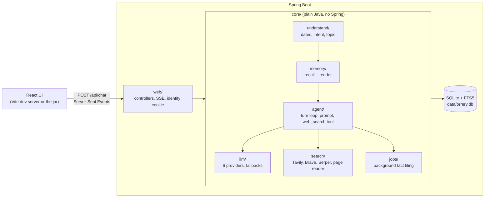

# Orrery

**Answers that know what day it is.** A chat agent with one tool, web search, that remembers what you asked and when, so it can tell you what has changed since.

> On Monday we shortlisted 5 CRM tools for a 20-person sales team. Has any of them changed pricing or shipped something big since?

Orrery works out which Monday that was, finds that conversation, reads back the prices it gave you then, searches the web for news since that day, and answers with a then / now / status table and a citation for every figure.

- **Backend**: Java 21, Spring Boot 4.1, SQLite with FTS5 full-text search
- **Frontend**: React 19, TypeScript, Vite 8, Tailwind CSS 4, three.js
- **Models**: OpenAI, Anthropic, Google Gemini, Groq, OpenRouter, or any OpenAI-compatible server
- **Search**: Tavily, Brave or Serper, with automatic failover

How it works and why: [DESIGN.md](DESIGN.md). A plain-language tour of every file: [docs/WALKTHROUGH.md](docs/WALKTHROUGH.md).

## Quick start

You need **Node.js 20.19+ or 22.12+**. Java 21 and Maven are optional: if they are missing, the first `npm run dev` downloads them into `.runtime/` inside the project (checksums verified).

```bash
npm install
npm run dev
```

Open **http://localhost:5173**. The first run creates `.env` from `.env.example` and the app shows which two keys to add. Both have free tiers with no card:

| Need | Free option | Variable |
|---|---|---|
| A model | [Groq](https://console.groq.com/keys) or [Google Gemini](https://aistudio.google.com/apikey) | `GROQ_API_KEY` or `GEMINI_API_KEY` |
| Web search | [Tavily](https://app.tavily.com/home), 1,000 searches a month | `TAVILY_API_KEY` |

Save `.env` and the backend restarts by itself with the new keys.

## Try it

Memory questions need a past. With `DEMO_TOOLS=true` (the default in `.env.example`) the empty screen offers **Load sample history**: it runs three real conversations through the agent, dated 3 November, this week's Monday and last Tuesday. Then ask the brief's questions:

- *On Monday we shortlisted 5 CRM tools for a 20-person sales team. Has any of them changed pricing or shipped something big since?*
- *What did I ask you on 3 November? Is your answer still correct today?*
- *Last Tuesday I asked you about Postgres hosting. Has any pricing changed since then?*

Also worth trying: a day with no conversation ("What did I ask you on 5 November?"), a fresh question ("What is the latest Node.js release?"), the **Re-check today** button under any answer, and the **demo clock** in the sidebar, which moves "now" for your browser.

## What it does

- **Resolves dates in your timezone.** "Last Tuesday", "on 3/11", "the day before yesterday", "since Monday", "in October". When a phrase could mean two days, the one with a matching conversation wins.
- **Recalls exactly.** The past question, the answer it gave, and the facts in it (prices, versions, plans) with the date they were true and their source.
- **Is honest about gaps.** No conversation that day? It says so, names the closest date it did find, and offers to answer fresh. It never invents a past.
- **Searches like a researcher.** Parallel searches, date-filtered news since the day in question, full page reads when a snippet lacks exact figures, primary sources preferred, every claim cited.
- **Streams everything it does.** You see the recalled day, each search and its date filter, then the answer as it is written. Stop works instantly.
- **Keeps a ledger.** The Memory page lists questions by day and a ledger of facts with their as-of dates, including what a value was before it changed.

## Architecture



`core` has no framework imports, so the agent can be tested and reasoned about on its own; `web` and `infra` adapt it to Spring Boot and SQLite. See [DESIGN.md](DESIGN.md) for the turn step by step.

## Project layout

```
orrery/
├── backend/                      Java 21 + Spring Boot (Maven)
│   └── src/main/java/app/orrery/
│       ├── core/
│       │   ├── understand/       dates ("last Tuesday"), intent, topic words
│       │   ├── memory/           recall from SQLite, Memory section of the prompt
│       │   ├── agent/            turn loop, prompt, web_search tool, fact extraction, demo seeding
│       │   ├── llm/              OpenAI-compatible and Anthropic streaming clients, model router
│       │   ├── search/           Tavily / Brave / Serper, safe page reader, caching
│       │   ├── store/            storage interface, full-text query builder
│       │   ├── jobs/             durable background jobs
│       │   └── json, util, time, config, events
│       ├── infra/                SQLite schema and queries (plain JDBC)
│       └── web/                  REST + SSE controllers, identity cookie, wiring
├── web/                          React + TypeScript frontend
│   └── src/  components/ hologram/ lib/ state/
├── scripts/                      npm launcher: toolchain, build, start, tests, eval
├── DESIGN.md                     one-page design
├── docs/WALKTHROUGH.md           plain-language tour and likely questions
└── .env.example                  every setting, documented
```

## Commands

| Command | What it does |
|---|---|
| `npm run dev` | Builds the backend if its sources changed, starts it, starts the UI with hot reload, restarts the backend when `.env` changes |
| `npm test` | UI type check and unit tests, then the backend JUnit suite |
| `npm run eval` | Runs the brief's questions plus honesty, freshness and small-talk probes against a running Orrery with real keys, and scores them |
| `npm run build` | Production build: the UI is packaged inside `backend/target/orrery.jar` |
| `npm start` | Runs that jar: UI and API on http://localhost:8080 |

## Configuration

All settings live in `.env`; see [.env.example](.env.example) for every option with comments. The main ones:

| Variable | Default | Meaning |
|---|---|---|
| `GROQ_API_KEY`, `GEMINI_API_KEY`, `OPENAI_API_KEY`, `ANTHROPIC_API_KEY`, `OPENROUTER_API_KEY` | | One model key is enough; with several, the first in this order wins: OpenAI, Anthropic, Gemini, Groq, OpenRouter |
| `LLM_PROVIDER` | `auto` | Force a provider, or `openai-compatible` with `LLM_BASE_URL` (Ollama, LM Studio, vLLM) |
| `LLM_MODEL`, `LLM_FAST_MODEL` | per provider | Override the answer model and the background model |
| `TAVILY_API_KEY`, `BRAVE_API_KEY`, `SERPER_API_KEY` | | At least one; several give failover |
| `DEMO_TOOLS` | `false` (`true` in `.env.example`) | Demo clock and sample history |
| `BACKEND_PORT` | `8080` | The next free port is used if taken |
| `ORRERY_DATA_DIR` | `./data` | Where the SQLite memory lives |

## API

| Method | Path | |
|---|---|---|
| `POST` | `/api/chat` | `{conversationId, message, recheckMessageId?}`; answers with Server-Sent Events |
| `POST` | `/api/chat/{turnId}/cancel` | Stops a running answer |
| `GET` | `/api/conversations` | Conversations, newest first |
| `GET` / `PATCH` / `DELETE` | `/api/conversations/{id}` | Messages with sources, searches, metrics and recall; rename; delete |
| `GET` | `/api/memory/timeline?days=180` | Questions grouped by local day |
| `GET` | `/api/memory/ledger` | Facts with their history |
| `DELETE` | `/api/memory` | Forget everything for this browser |
| `GET` | `/api/status`, `/api/health` | Setup state, clock, liveness |
| `POST` | `/api/dev/clock`, `/api/dev/seed-demo` | Demo tools (only with `DEMO_TOOLS=true`) |

Stream events, in order of appearance: `turn.started`, `memory.recalled`, `status`, `search.started`, `search.completed`, `text.delta`, `text.reset`, `warning`, `conversation.titled`, then `turn.completed` or `turn.failed`. Each browser gets its own memory through an HttpOnly cookie; requests carry the browser's timezone.

## Tests

- **Backend**: 86 JUnit tests. Date phrases across weeks and timezones, intent detection, the JSON codec, SQLite queries and full-text ranking, memory recall for each of the brief's questions, both streaming protocols (OpenAI-style and Anthropic) against local fake servers, model fallback and retries, search failover, the URL safety guard, and whole turns end to end over real sockets.
- **Frontend**: TypeScript strict mode and Vitest for the SSE parser, citations, dates, status tables and conversation rebuilding.
- **End to end**: `npm run eval` with real keys.

## License

MIT. See [LICENSE](LICENSE).
